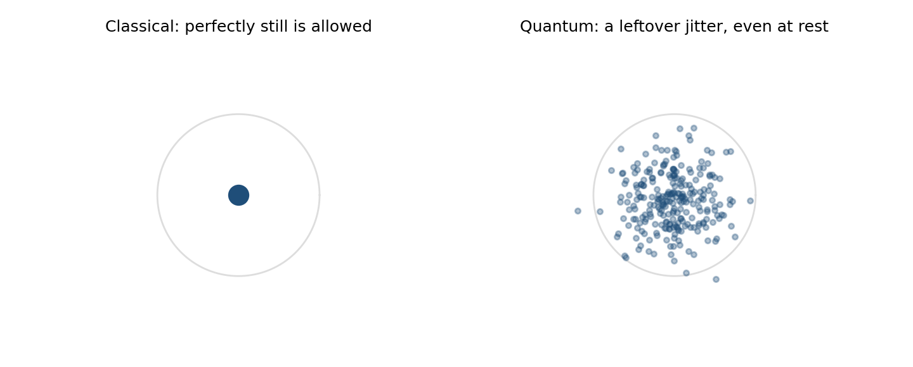
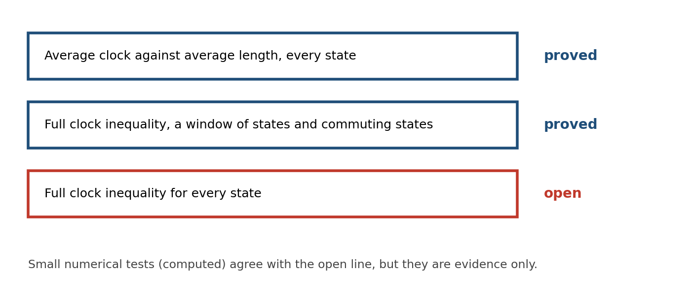
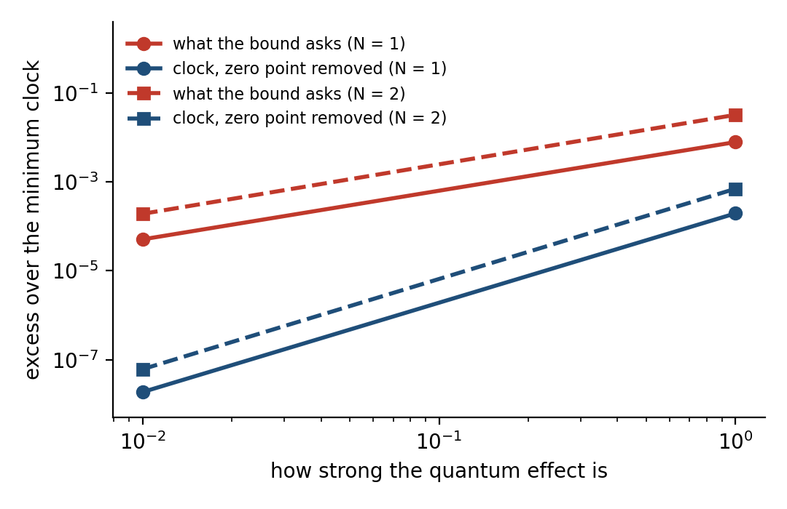

DOI of this text: [doi:10.5281/zenodo.24576562](https://doi.org/10.5281/zenodo.24576562)

This is an introductory text to the research paper *A one-mode quantization of the clock bound on a null cone, and its sensitivity to operator ordering* [[Per26]](https://doi.org/10.5281/zenodo.24575468), by the same author. The paper has the proofs and the computations. This note has the idea. No equations are needed to follow it. It makes no claim the paper does not make, and it says which claims are proved and which are only computed.

Three cautions come first, because the paper puts them first. This is about a **reduced model**: one ray, one pattern of distortion, one direction of squeezing. It is not about full quantum gravity. The ordering result holds **at the vacuum, the quietest quantum state, and for a small quantum effect**, not for every state and every strength. And the main question, whether the bound holds as a full statement about operators, is **left open**.

# A clock that cannot run forever

Take a cone of light, the surface swept out by a flash. Gravity focuses its rays, so a ray can only travel so far before the cone folds over itself. The distance it can travel is its **clock**. A companion paper [[Per26b]](https://doi.org/10.5281/zenodo.24572220) proved an exact rule for this clock. The more the shape of the light is distorted along the way, the shorter the clock. Turned around: **a large distortion needs a long clock.** The rule is a sharp lower bound on the clock in terms of the total distortion. This part is **proved**, in that earlier paper, and it is not new here.

The new question is a quantum one. Light and gravity are not classical at the smallest scales. Recent work by Chandrasekaran [[Cha26]](https://arxiv.org/abs/2611.34924) builds a quantum version of the cone, where the distortion and the clock are no longer numbers but **operators**, objects that act on a quantum state. Does the clock rule survive?

# What is different when things are quantum

Two things change, and both matter.

First, a quantum system is never perfectly still. A classical pendulum can hang motionless. A quantum one cannot: even in its lowest state it keeps a small leftover motion, called **zero-point energy**. The distortion of the light inherits this jitter. In the quietest state, the **vacuum**, the average distortion is not zero. The paper proves it grows like the square root of a small number called **kappa**, which measures how strong the quantum effect is.

{width=90%}

Second, an operator formula can be written in more than one way. Take a product of two quantities that do not commute, so that their order matters. Different orderings give different operators, and they differ by terms of the order of Planck's constant. This is the **ordering problem**. The source scheme [Cha26] uses one specific ordering, called **Weyl ordering**. It never removes the zero-point term. The other common choice, **normal ordering**, removes it by hand.

# The model

To get exact answers the paper cuts the problem down. It keeps one ray of the cone, one angular pattern and one direction of squeezing. The ray is cut into a finite number of cells, so the system has a finite number of quantum modes. The area of the cone and a boundary term that the source does not pin down are fixed, the boundary term at zero. The paper lists each of these reductions. Everything below is a statement about this model.

# What the paper proves

The first result holds in the model, for any number of modes and for **every** quantum state. On average, the clock is at least the classical bound evaluated at the average distortion. This is **proved**. It is the quantum version of the rule, in its expectation form, and it needs no assumption on the state. The proof uses two tools: a tangent line under the exponential, and a Cauchy-Schwarz inequality that stays valid even when the quantities do not commute. A stronger form, with the root-mean-square distortion, is also **proved**.

Two further results are **proved** for the full operator statement, not just averages. One is a whole family of operator bounds, one for each choice of a free function. The other is the exact operator inequality on a window of states where the distortion is small enough, and on states that commute with the distortion.

{width=85%}

What is **not** proved is the full operator inequality for every state. The paper states it as a conjecture, explains where the standard tools fail, and gives the obstruction: control of the off-diagonal terms in a certain basis. Small numerical tests, for one to three modes, find the inequality true, with its lowest eigenvalue positive. This is **computed**. It is evidence and not a proof, since the method gives only upper bounds on that eigenvalue. The four-mode runs have not converged, and the paper says so.

# The surprise: ordering matters

Here is the main new finding. Remove the zero-point term by normal ordering, and keep everything else, so that the distortion still jitters and the clock does not. Then, at the vacuum and for small kappa, **the bound fails**. This is **proved**.

The reason is a matter of sizes. The cost of a nonzero average distortion grows almost linearly in kappa, a little more slowly by a logarithm. The clock, once its zero point is removed, rises above its minimum only like kappa squared. For small kappa the second is far smaller than the first, so the clock falls short. The Weyl-ordered clock keeps its zero-point lift, which is linear in kappa, and that lift covers the cost.

{width=80%}

The numbers are striking. For one mode at the smallest quantum effect in the table, the bound asks for an excess about **2,700 times** larger than the zero-point-free clock provides, and at the strongest, about 40 times. These are **computed**, read from the paper's table.

Is it all or nothing? No, and this part is **proved** too. Remove any fraction of the zero-point term that is less than one, say ninety-nine percent, and the bound survives at the vacuum for small enough kappa. Relative to the length term, the margin even grows as kappa shrinks. Only removing the whole term breaks it. So the bound is sensitive to the ordering at the first order in Planck's constant, and it holds when the zero point is kept.

A related fact is also proved. The normal-ordered shear loses its positivity: it has negative values, while the classical shear is never negative.

# How this relates to known results

This echoes a known story. In quantum field theory, normal ordering is known to break the positivity of the energy density. The **quantum energy inequalities** of Ford and Roman [FR97], Fewster [Few12] and others, which are lower bounds on averaged normal-ordered energy, exist exactly to deal with that. The loss we find is the analogue for a clock. We are careful about what we claim. We prove a sharp clock inequality and its failure threshold in the reduced model. We do **not** claim the loss of positivity itself, which is known. The papers on quantum energy inequalities were read by abstract only, and the paper says so.

# What is new

All of this is **proved** unless stated otherwise.

- **The expectation bound.** For any number of modes and every state, the quantum clock obeys the classical rule on average.
- **The operator family bound** and the exact inequality on a window of states.
- **The ordering result.** Full normal ordering breaks the bound at the vacuum for small kappa. Removing any fraction below one does not.
- **A finiteness threshold.** The clock has a finite vacuum value only for kappa below a threshold. The exact criterion is proved, and the threshold values, such as 18.6 for one mode at starting size 0.1, are **computed**.
- **The open problem**, with its obstruction and small-size numerics, **computed**.

Not new: the Weyl ordering, the clock operator and its commutation rule come from [Cha26], and the classical bound comes from [Per26b].

# Why it matters

Quantum-gravity schemes need statements that survive quantization, and the ordering of operators is a place where they can quietly fail. This work shows that a natural focusing statement for a quantum clock holds with the source scheme's ordering and breaks with a plausible alternative, and it says why: the zero-point energy. It also marks the open problem sharply, so that others can attack it.

# What this note does not do

It does not prove anything. It does not say the result holds beyond the reduced model, away from the vacuum for the ordering result, or for a large quantum effect. The source [Cha26] is an unrefereed first version, and the paper says no claim here is about the full quantum gravity theory. Every item above marked proved is proved in the paper, and every item marked computed is computed there.

# Where to go next

- The paper itself [Per26], with the proofs and the numerical tables.
- The classical result it quantizes [Per26b].
- The source scheme [Cha26].
- The geometric view of light and the hyperbolic plane behind the classical paper comes from Jason Glowney's *Arithmoí*, Book 1 [Glo23].

# Acknowledgements {-}

We are grateful to Jason Glowney, whose geometric treatment of light, the light cone and hyperbolic curvature in *Arithmoí*, Book 1, led us to the hyperbolic-plane view of null data on which the classical paper, and hence this work, is built.

# References {-}

[Cha26] V. Chandrasekaran, *An algebraic quantization of gravity from the null cone*, 2026, [arXiv:2611.34924](https://arxiv.org/abs/2611.34924).

[Few12] C. J. Fewster, *Lectures on quantum energy inequalities*, [arXiv:1208.5399](https://arxiv.org/abs/1208.5399).

[FR97] L. H. Ford and T. A. Roman, *Restrictions on negative energy density in flat spacetime*, Phys. Rev. D 55 (1997) 2082, [doi:10.1103/PhysRevD.55.2082](https://doi.org/10.1103/PhysRevD.55.2082).

[Glo23] J. Glowney, *Arithmoí: A Study of Mathematical Cohesiveness in Physics and Metaphysics*, Book 1, First Edition, Athene Noctua, 2023.

[Per26] M. Perreault, *A one-mode quantization of the clock bound on a null cone, and its sensitivity to operator ordering*, 2026, Zenodo. [doi:10.5281/zenodo.24575468](https://doi.org/10.5281/zenodo.24575468).

[Per26b] M. Perreault, *Affine length bounds the conformal excursion on a null cone: a sharp focusing inequality*, 2026, Zenodo. [doi:10.5281/zenodo.24572220](https://doi.org/10.5281/zenodo.24572220).

```{=latex}
\par\ifdim\dimexpr\pagegoal-\pagetotal\relax<15\baselineskip\ifdim\pagetotal>0pt\newpage\fi\fi
```

# Use of AI {-}

Claude (Anthropic) was used in November 2026, under the author's direction, for exploratory computation, derivations, code, checks, literature search and drafting.

# Read the research paper {-}

```{=latex}
\raggedright
```

The full paper, with the proofs, is *A one-mode quantization of the clock bound on a null cone, and its sensitivity to operator ordering*, by Michaël Perreault.

DOI: [doi:10.5281/zenodo.24575468](https://doi.org/10.5281/zenodo.24575468)
